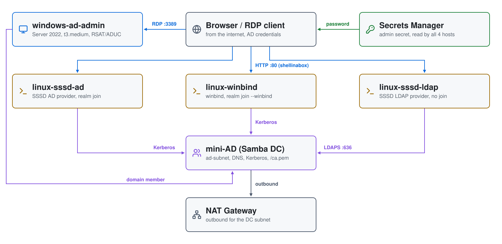
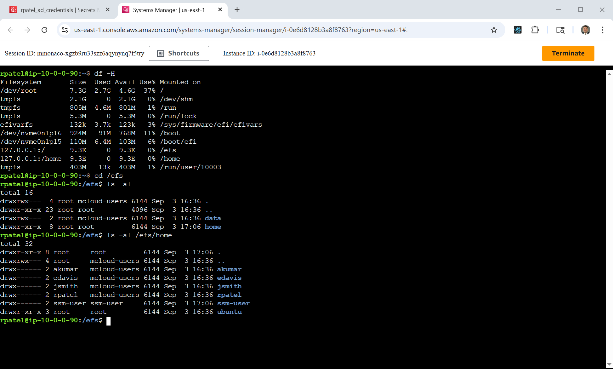
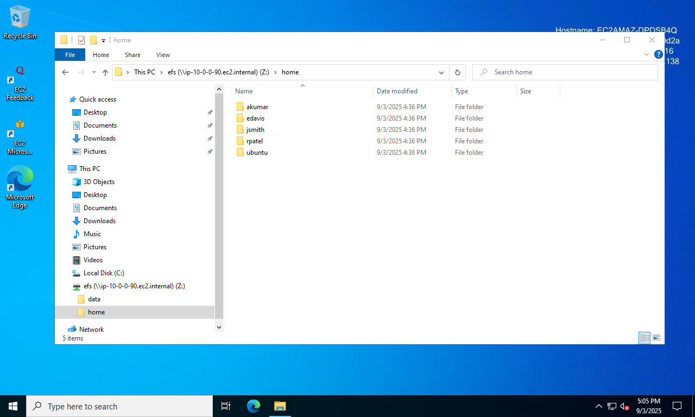

# Linux + Active Directory on AWS: SSSD-ad vs Winbind vs SSSD-ldap

A hands-on lab that connects **three Ubuntu machines to the same mini-AD
three different ways**, so you can compare the approaches side by side. All
three read the **same POSIX `uidNumber`/`gidNumber` from AD**, so a user has
the same UID on every box. A Windows admin host with ADUC lets you watch the
AD side of each method.

| Instance | Method | How it connects | ID mapping | Computer object in AD |
|---|---|---|---|---|
| `linux-sssd-ad` | **SSSD, AD provider** | `realm join` (Kerberos) | POSIX (`ldap_id_mapping = False`) | yes |
| `linux-winbind` | **Winbind** | `realm join --client-software=winbind` | POSIX (`idmap backend = ad`) | yes |
| `linux-sssd-ldap` | **SSSD, LDAP provider** | **no join**: LDAPS with a bind account | POSIX (`ldap_id_mapping = False`) | **no** |
| `windows-ad-admin` | domain member | `Add-Computer` | n/a | yes |

Each Linux box runs **shellinabox on port 80**, so you test by browsing to
`http://<instance>` and signing in as a domain user. That exercises the box's
PAM and identity stack exactly as SSH would.

## Architecture

<picture>
  <source media="(prefers-color-scheme: dark)" srcset="architecture-dark.svg">
  
</picture>

Regenerate with `python3 make_diagram.py`.

- **`01-directory/`**: the VPC (`efs-vpc`) with public VM subnets and a
  private DC subnet, the NAT gateway, the AD passwords in Secrets Manager,
  and the [`module-aws-mini-ad`](https://github.com/mamonaco1973/module-aws-mini-ad)
  Samba DC with users and POSIX attributes from
  `scripts/users.json.template`. DHCP points the VPC's DNS at the DC.
- **`02-servers/`**: the three Ubuntu clients (`t3.small`, one per
  method, each with its own `userdata_*.sh`) and the Windows admin host
  (`t3.medium`).

## The SSSD-ldap catch: it needs a CA

The LDAP provider authenticates with a simple bind, so it **must** run over
LDAPS, and the client has to trust the DC's TLS certificate. A Samba DC
generates its own CA, and the mini-AD module serves it at
`http://<dc>/ca.pem`, so `linux-sssd-ldap` downloads it at boot into
`/etc/sssd/mini-ad-ca.pem`. Against AWS Managed Microsoft AD you'd deploy
AD CS instead and distribute its root.

| User | Groups | sudo on Linux |
|---|---|---|
| jsmith | mcloud-users, us, linux-admins, Domain Admins | yes |
| edavis | mcloud-users, us | no |
| rpatel | mcloud-users, india, linux-admins, Domain Admins | yes |
| akumar | mcloud-users, india | no |

| Group | gidNumber |
|---|---|
| mcloud-users | 10001 |
| us | 10002 |
| india | 10003 |
| linux-admins | 10004 |

## Security groups

```
internet ─80, 22, 445─▶ linux-sssd-ad, linux-winbind, linux-sssd-ldap
internet ─3389────────▶ windows-ad-admin
```

`efs-ssh-security-group` and `efs-rdp-security-group` allow those ports from `0.0.0.0/0`. The DC has no
public address.

## Prerequisites

* [An AWS Account](https://aws.amazon.com/console/)
* [Install AWS CLI](https://docs.aws.amazon.com/cli/latest/userguide/getting-started-install.html)
* [Install Terraform](https://developer.hashicorp.com/terraform/install)
* [Install jq](https://jqlang.github.io/jq/download/)

If this is your first time watching our content, we recommend starting with
this video: [AWS + Terraform: Easy Setup](https://youtu.be/BCMQo0CB9wk).

## Deploy

```bash
git clone https://github.com/mamonaco1973/aws-linux-ad.git
cd aws-linux-ad
./apply.sh       # 1: VPC + mini-AD + secrets  2: three Linux clients + Windows host
```

Everything deploys to `us-east-1`. `apply.sh` ends by running
`validate.sh`, which waits for shellinabox on each Linux client and prints a
browser URL for each, plus the Windows host:

```
============================================================================
Linux + Active Directory - Three-Way Quick Start
============================================================================

NOTE: SSSD (AD provider)     -> http://ec2-203-0-113-11.compute-1.amazonaws.com
NOTE: Winbind only           -> http://ec2-203-0-113-12.compute-1.amazonaws.com
NOTE: SSSD (LDAP provider)   -> http://ec2-203-0-113-13.compute-1.amazonaws.com
NOTE: Windows ADUC host (RDP)   -> ec2-203-0-113-20.compute-1.amazonaws.com
```

## Try it

1. Get a user's password:

   ```bash
   aws secretsmanager get-secret-value --secret-id jsmith_ad_credentials_efs \
     --query SecretString --output text | jq -r .password
   ```

2. Open each Linux URL, sign in as `jsmith`, and run the same commands on all
   three:

   ```bash
   id jsmith
   getent passwd jsmith
   getent group linux-admins
   getent group mcloud-users
   ```

   

3. RDP to the Windows host as `MCLOUD\jsmith` and open **Active Directory
   Users and Computers**: computer objects exist for `linux-sssd-ad` and
   `linux-winbind`, but not for `linux-sssd-ldap`.

   

## Troubleshooting

| Symptom | Fix |
|---|---|
| A Linux URL doesn't load | That box is still booting; `validate.sh` waits for each. `aws ssm start-session --target <instance-id>` and read its cloud-init log. |
| `linux-sssd-ldap` can't authenticate | It must trust the DC's CA: check `/etc/sssd/mini-ad-ca.pem` exists and that `curl http://<dc>/ca.pem` works from the box. |
| `id jsmith` differs between boxes | It shouldn't: all three use the POSIX IDs in AD. `sudo sss_cache -E` (SSSD) or `sudo net cache flush` (winbind) clears stale lookups. |

## Teardown

```bash
./destroy.sh     # destroys both phases and deletes the demo secrets
```

## Notes

- **Lab only.** shellinabox is plain HTTP on port 80, the security groups are
  open to `0.0.0.0/0`, and `linux-sssd-ldap` uses the domain `Admin` as its
  bind account, so that password is in its `sssd.conf`.
- The secret and VPC names end in `_efs` / `efs-vpc` because this lab was
  built from the aws-efs project.
